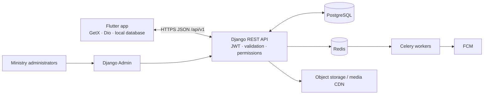

# UDM technical architecture

## System boundaries

The Flutter app is the student-facing client. It owns presentation, local cache, offline actions, and sync state; it does not own authorization rules or canonical content. Django REST Framework is the system of record for identity, permissions, ministry content, community, and progress. PostgreSQL stores structured data. Redis/Celery handles scheduled publishing, reminders, and media or notification jobs. Cloud object storage/CDN serves images, audio, and video; the API stores metadata and signed or provider-hosted URLs, not large media payloads. Firebase Cloud Messaging delivers push notifications. Django Admin is the first content operations console.

## Mobile structure

Use feature-first modules (`authentication`, `home`, `devotions`, `bible`, `courses`, `prayer`, `community`, `campus`, `events`, `progress`, `profile`). Each feature separates views/widgets, GetX controllers and bindings, domain models/use cases, and data repositories/data sources. `core` owns theme, routing, API client, storage, connectivity, error mapping, shared widgets, and sync infrastructure. Controllers orchestrate; widgets render. Repository interfaces keep UI independent of HTTP and local storage implementations.

## Backend structure

Use a Django project with versioned API modules and domain apps: `accounts`, `campuses`, `content` (devotions/articles/media), `bible`, `learning` (courses/quizzes), `community`, `prayer`, `events`, `progress`, and `notifications`. Keep serializers and views thin; put business rules in services and authorization in explicit DRF permissions/querysets. Use UUID public identifiers, database constraints, indexes for feed/filter paths, and pagination by default. Private journal data is accessible only to its owner; admin access is not implied by staff status.

## API and client behavior

Expose JSON under `/api/v1/`; document with OpenAPI. JWT access tokens are short-lived, refresh tokens rotate and can be revoked. Public content may be browsed anonymously; personal progress and community writes require authentication. Responses use standard HTTP status semantics and field-level validation errors. The mobile client caches only content explicitly marked cacheable, records pending progress/notes locally, and synchronizes idempotently when online. Server timestamps and stable operation IDs resolve retries; conflicting private edits preserve a recoverable local copy.

## Security and privacy boundaries

Enforce campus/group scope on the server for every read and write. Apply object permissions, throttling to authentication and public submissions, upload validation, audit events for privileged changes, and account deletion/export workflows. Do not send prayer journals or private notes to analytics, push payloads, or admin listings. Bible content is loaded only from public-domain or licensed sources; each translation records license and attribution metadata.

## Environments and operations

Separate development, staging, and production settings and secrets. PostgreSQL backups and restore drills, structured logs, health checks, error monitoring, and migration review are production requirements. Keep media out of Django request/response streaming. The local stack is intended to be Docker Compose based once backend bootstrap is added.
